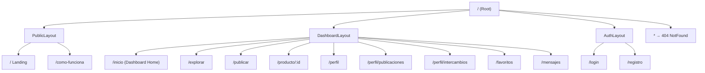
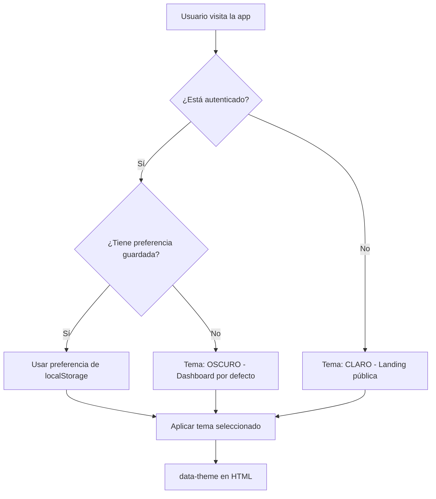

# 📋 Planificación Técnica — TrueX Trade Frontend

> **Proyecto:** TrueX Trade — Plataforma web de trueques en línea  
> **Segmento:** Frontend (SPA)  
> **Fecha:** 21 de octubre de 2026  
> **Stack actual:** React 19 + Vite 8 + React Router DOM 7 + Vanilla CSS  

---

## 1. Visión General del Producto

**TrueX** es una plataforma de intercambio (trueque) de objetos entre personas. Los usuarios pueden publicar artículos que ya no usan, explorar lo que otros ofrecen y concretar intercambios sin dinero de por medio. Opcionalmente también se soporta la modalidad de venta.

> [!IMPORTANT]
> La aplicación tiene dos variantes visuales: un **modo claro** (landing page pública) y un **modo oscuro** (dashboard de usuario autenticado). Ambos deben coexistir con soporte de tema dinámico.

---

## 2. Análisis de Material Gráfico

### 2.1 Logos disponibles

````carousel

<!-- slide -->

<!-- slide -->

````

| Variante | Uso recomendado |
|----------|-----------------|
| **Isotipo** (`Logo.png`) | Favicon, ícono de app, avatar de carga |
| **Horizontal** (`Logo alado.png`) | Navbar (desktop), header de emails |
| **Vertical** (`Logo abajo.png`) | Footer, pantallas de login/registro, splash |

### 2.2 Mockup — Modo Claro (Landing / Público)


**Elementos identificados en el mockup claro:**

| # | Sección | Descripción |
|---|---------|-------------|
| 1 | **Navbar pública** | Logo horizontal + links (Inicio, Explorar, Categorías, Cómo funciona, Comunidad) + barra de búsqueda + botones "Iniciar sesión" / "Registrarse" |
| 2 | **Hero Banner** | Título "Intercambia lo que ya no usas, encuentra lo que sí necesitas" con texto naranja destacado, flechas doradas, imagen de cámara. CTAs: "Comienza ahora →" y "▶ Cómo funciona" |
| 3 | **Stats bar** | +10K Usuarios activos · +25K Objetos publicados · +8K Intercambios realizados · 4.8 Calificación promedio |
| 4 | **Categorías** | Grid horizontal con íconos: Tecnología, Ropa, Hogar, Deportes, Vehículos, Libros, Instrumentos, Juguetes, Coleccionables, Otros + "Ver todas >" |
| 5 | **Publicaciones recientes** | Cards horizontales: imagen, título, estado, badge (Trueque/Venta), ubicación, corazón favorito |
| 6 | **¿Cómo funciona?** | 4 pasos ilustrados: 1) Regístrate → 2) Publica → 3) Intercambia → 4) Dale una nueva vida |
| 7 | **CTA final** | Banner "Únete a una comunidad que da valor a lo que tiene" + botón "Crear cuenta gratis →" |
| 8 | **Vista mobile** | Sidebar derecho mostrando interfaz mobile: barra de búsqueda, filtros por categoría, cards de publicaciones, bottom navigation (Inicio, Explorar, Publicar, Mensajes, Perfil) |

### 2.3 Mockup — Modo Oscuro (Dashboard / Autenticado)


**Elementos identificados en el mockup oscuro:**

| # | Sección | Descripción |
|---|---------|-------------|
| 1 | **Navbar autenticada** | Logo + tabs activas (Inicio, Explorar, + Publicar, Mensajes con badge 3, Notificaciones con badge 5) + avatar de usuario con dropdown |
| 2 | **Hero Dashboard** | "Intercambia tus objetos" con palabra "objetos" en naranja cursiva. Imagen con celular, control de juegos, audífonos y tenis con flechas de intercambio. CTA: "🔍 Explorar objetos" |
| 3 | **Barra de categorías** | Íconos circulares con borde: Tecnología, Videojuegos, Ropa y Calzado, Deportes, Hogar, Libros, Música, Más |
| 4 | **Publicaciones recientes** | Cards con imagen real, título, ubicación (📍 Pasto, Nariño), badge tipo (Trueque / Trueque + Venta), ícono de bookmark y de intercambio |
| 5 | **Sidebar - Perfil** | Foto circular, nombre "David Garcia", @davidgx, badge "✅ Verificado", stats: 12 Publicaciones · 8 Intercambios · 4.8 Calificación, botón "Mi perfil" |
| 6 | **Sidebar - Accesos rápidos** | Mis publicaciones, Mis intercambios, Favoritos, Lista de deseos |
| 7 | **Sidebar - Publicar** | Card CTA "Publica tu objeto — Es fácil y rápido" con botón "Publicar ahora" |

---

## 3. Paleta de Colores y Design Tokens

Basado en el análisis de los mockups:

```css
/* === MODO CLARO (Landing pública) === */
--claro-bg:            #FFFFFF;
--claro-bg-alt:        #F9F9F7;
--claro-surface:       #FFFFFF;
--claro-text:          #1A1A1A;
--claro-text-muted:    #6B7280;
--claro-border:        #E5E7EB;
--claro-primary:       #E8860C;       /* Naranja TrueX */
--claro-primary-dark:  #C46F08;
--claro-primary-light: #FFF3E0;
--claro-accent:        #F59E0B;       /* Naranja dorado */

/* === MODO OSCURO (Dashboard autenticado) === */
--oscuro-bg:           #0D0D0D;
--oscuro-bg-alt:       #1A1A1A;
--oscuro-surface:      #1E1E1E;
--oscuro-surface-alt:  #2A2A2A;
--oscuro-text:         #F5F5F5;
--oscuro-text-muted:   #9CA3AF;
--oscuro-border:       #333333;
--oscuro-primary:      #E8860C;       /* Naranja TrueX (consistente) */
--oscuro-primary-dark: #C46F08;
--oscuro-primary-light: rgba(232, 134, 12, 0.15);
--oscuro-accent:       #F59E0B;
```

> [!TIP]
> La paleta de colores debe usar **CSS custom properties** con un sistema de temas mediante un atributo `data-theme` en el `<html>`. El color primario naranja (#E8860C) es constante en ambos modos.

---

## 4. Tipografía

| Elemento | Fuente | Peso | Tamaño |
|----------|--------|------|--------|
| Logo/Marca | **Outfit** (Google Fonts) | 800 | — |
| Headings | **Inter** | 700 | clamp(1.5rem, 4vw, 3rem) |
| Body | **Inter** | 400 | 0.95rem - 1rem |
| Botones/Labels | **Inter** | 600 | 0.875rem - 0.95rem |
| Caption/Muted | **Inter** | 400 | 0.8rem - 0.875rem |

---

## 5. Arquitectura de Carpetas Propuesta

```
src/
├── assets/
│   ├── icons/               # Íconos SVG de categorías y UI
│   ├── images/              # Imágenes estáticas (hero, etc.)
│   └── logos/               # Logo.png, Logo-alado.png, Logo-abajo.png
│
├── components/
│   ├── common/              # Componentes reutilizables
│   │   ├── Button.jsx
│   │   ├── Badge.jsx
│   │   ├── SearchBar.jsx
│   │   ├── Avatar.jsx
│   │   ├── StatCard.jsx
│   │   ├── EmptyState.jsx
│   │   └── ThemeToggle.jsx
│   │
│   ├── cards/               # Tarjetas de artículos
│   │   ├── ArticleCard.jsx          # Card de publicación
│   │   ├── ArticleCardSkeleton.jsx  # Skeleton loading
│   │   └── PublishCTACard.jsx       # CTA "Publica tu objeto"
│   │
│   ├── navigation/          # Navegación
│   │   ├── Navbar.jsx               # Navbar desktop
│   │   ├── NavbarAuth.jsx           # Navbar autenticado
│   │   ├── BottomNav.jsx            # Bottom nav mobile
│   │   └── UserMenu.jsx             # Dropdown de usuario
│   │
│   ├── sections/            # Secciones de página
│   │   ├── HeroPublic.jsx           # Hero landing (modo claro)
│   │   ├── HeroDashboard.jsx        # Hero dashboard (modo oscuro)
│   │   ├── CategoryBar.jsx          # Barra de categorías
│   │   ├── RecentPublications.jsx   # Publicaciones recientes
│   │   ├── HowItWorks.jsx           # ¿Cómo funciona?
│   │   ├── StatsBar.jsx             # Barra de estadísticas
│   │   └── CTABanner.jsx            # Banner CTA final
│   │
│   ├── sidebar/             # Sidebar del dashboard
│   │   ├── ProfileCard.jsx          # Card de perfil
│   │   ├── QuickLinks.jsx           # Accesos rápidos
│   │   └── Sidebar.jsx              # Contenedor sidebar
│   │
│   └── Footer.jsx
│
├── context/
│   ├── AuthContext.jsx       # Estado de autenticación
│   └── ThemeContext.jsx      # Estado del tema (claro/oscuro)
│
├── data/
│   ├── items.js              # Mock de artículos
│   ├── categories.js         # Categorías con íconos
│   └── stats.js              # Estadísticas mock
│
├── hooks/
│   ├── useAuth.js            # Hook de autenticación
│   ├── useTheme.js           # Hook de tema
│   └── useMediaQuery.js      # Hook responsive
│
├── layouts/
│   ├── PublicLayout.jsx      # Layout para landing (modo claro)
│   ├── DashboardLayout.jsx   # Layout con sidebar (modo oscuro)
│   └── AuthLayout.jsx        # Layout para login/registro
│
├── pages/
│   ├── public/               # Páginas públicas
│   │   ├── Landing.jsx              # Home pública (modo claro)
│   │   └── ComoFunciona.jsx         # Página explicativa
│   │
│   ├── auth/                 # Autenticación
│   │   ├── Login.jsx
│   │   └── Registro.jsx
│   │
│   ├── dashboard/            # Páginas autenticadas
│   │   ├── Home.jsx                 # Dashboard principal
│   │   ├── Explorar.jsx             # Explorar/buscar objetos
│   │   ├── Publicar.jsx             # Publicar un artículo
│   │   ├── ItemDetail.jsx           # Detalle de artículo
│   │   ├── Perfil.jsx               # Mi perfil
│   │   ├── MisPublicaciones.jsx     # Mis publicaciones
│   │   ├── MisIntercambios.jsx      # Mis intercambios
│   │   ├── Favoritos.jsx            # Artículos favoritos
│   │   └── Mensajes.jsx             # Chat/mensajes
│   │
│   └── NotFound.jsx
│
├── services/
│   ├── api.js                # Configuración base de API
│   ├── auth.service.js       # Endpoints de autenticación
│   ├── items.service.js      # CRUD de artículos
│   ├── users.service.js      # Endpoints de usuarios
│   └── messages.service.js   # Endpoints de mensajes
│
├── styles/
│   ├── index.css             # Variables globales + reset + temas
│   ├── components/           # Estilos por componente
│   │   ├── navbar.css
│   │   ├── footer.css
│   │   ├── cards.css
│   │   ├── buttons.css
│   │   ├── forms.css
│   │   ├── sidebar.css
│   │   ├── hero.css
│   │   └── categories.css
│   ├── layouts/
│   │   ├── public.css
│   │   ├── dashboard.css
│   │   └── auth.css
│   └── utils.css             # Utilidades (.container, .grid, .muted, etc.)
│
├── utils/
│   ├── constants.js          # Constantes de la app
│   └── formatters.js         # Formateo de fechas, números, etc.
│
├── App.jsx
└── main.jsx
```

---

## 6. Sistema de Rutas



| Ruta | Layout | Componente | Acceso |
|------|--------|-----------|--------|
| `/` | PublicLayout | Landing.jsx | Público |
| `/como-funciona` | PublicLayout | ComoFunciona.jsx | Público |
| `/login` | AuthLayout | Login.jsx | Público |
| `/registro` | AuthLayout | Registro.jsx | Público |
| `/inicio` | DashboardLayout | Home.jsx | Autenticado |
| `/explorar` | DashboardLayout | Explorar.jsx | Autenticado |
| `/publicar` | DashboardLayout | Publicar.jsx | Autenticado |
| `/producto/:id` | DashboardLayout | ItemDetail.jsx | Autenticado |
| `/perfil` | DashboardLayout | Perfil.jsx | Autenticado |
| `/perfil/publicaciones` | DashboardLayout | MisPublicaciones.jsx | Autenticado |
| `/perfil/intercambios` | DashboardLayout | MisIntercambios.jsx | Autenticado |
| `/favoritos` | DashboardLayout | Favoritos.jsx | Autenticado |
| `/mensajes` | DashboardLayout | Mensajes.jsx | Autenticado |
| `*` | — | NotFound.jsx | Público |

---

## 7. Componentes — Especificación Detallada

### 7.1 Navbar Pública (`Navbar.jsx`)
**Ubicación mockup:** Modo claro, parte superior

| Prop / Estado | Tipo | Descripción |
|---------------|------|-------------|
| Logo horizontal | Image | `Logo alado.png` |
| Links | Array | Inicio, Explorar, Categorías, Cómo funciona, Comunidad |
| SearchBar | Component | Input con ícono 🔍 y placeholder "Buscar productos..." |
| Auth buttons | Buttons | "Iniciar sesión" (outline) + "Registrarse" (primary naranja) |

**Comportamiento:**
- Sticky top con `z-index: 100`
- En mobile (< 768px): hamburger menu + SearchBar colapsa
- Fondo blanco semitransparente con blur (`backdrop-filter: blur(10px)`)

### 7.2 Navbar Autenticada (`NavbarAuth.jsx`)
**Ubicación mockup:** Modo oscuro, parte superior

| Elemento | Descripción |
|----------|-------------|
| Logo | `Logo alado.png` (versión clara para fondo oscuro) |
| Tabs activas | Inicio (🏠), Explorar (⊞), + Publicar, Mensajes (💬 badge), Notificaciones (🔔 badge) |
| Avatar usuario | Imagen circular + dropdown chevron |

**Comportamiento:**
- Fondo oscuro (`#1A1A1A`) con borde inferior sutil
- Badge numérico en Mensajes y Notificaciones con color primario
- Dropdown del avatar: Mi perfil, Mis publicaciones, Configuración, Cerrar sesión

### 7.3 ArticleCard (`ArticleCard.jsx`)
**Dos variantes según mockup:**

**Variante Público (modo claro):**
- Imagen del producto (aspect-ratio 4:3)
- Corazón (♡) para favorito en esquina superior derecha
- Título del artículo
- Estado ("Buen estado", "Excelente estado")
- Badge tipo: "Trueque" (naranja) o "Venta" (verde)
- Ubicación (📍 Pasto)

**Variante Dashboard (modo oscuro):**
- Imagen con borde redondeado
- Bookmark (🔖) en esquina superior derecha
- Título del artículo
- Ubicación (📍 Pasto, Nariño)
- Badge tipo: "Trueque" o "Trueque / Venta"
- Ícono de intercambio (⇄)

```
┌──────────────────────┐
│  ┌──────────────┐  ♡ │
│  │              │    │
│  │    IMAGEN    │    │
│  │              │    │
│  └──────────────┘    │
│  Título artículo     │
│  Buen estado         │
│  ┌────────┐  📍City  │
│  │Trueque │          │
│  └────────┘          │
└──────────────────────┘
```

### 7.4 HeroPublic (`HeroPublic.jsx`)
**Ubicación mockup:** Modo claro, sección principal

- Título con texto dinámico: "Intercambia lo que ya no usas, encuentra lo que **sí necesitas**." (naranja cursiva en "sí necesitas")
- Subtítulo descriptivo
- Imagen decorativa (cámara con flechas doradas)
- CTA primario: "Comienza ahora →" (botón naranja)
- CTA secundario: "▶ Cómo funciona" (botón outline)
- Fondo con gradiente sutil naranja/dorado

### 7.5 HeroDashboard (`HeroDashboard.jsx`)
**Ubicación mockup:** Modo oscuro, sección principal

- Título: "Intercambia tus **objetos**" (cursiva naranja)
- Subtítulo: "Dale una nueva vida a lo que ya no usas. TrueX, la comunidad de trueques."
- Imagen con objetos flotantes (celular, control, audífonos, tenis) y flechas de intercambio
- CTA: "🔍 Explorar objetos" (botón naranja pill)
- Fondo oscuro con gradiente naranja/negro diagonal
- Texto "Más que objetos, **oportunidades**" en la imagen

### 7.6 CategoryBar (`CategoryBar.jsx`)

| Categoría | Ícono | Visible en |
|-----------|-------|------------|
| Todos | ⊞ | Solo modo claro |
| Tecnología | 📱 | Ambos |
| Videojuegos | 🎮 | Solo modo oscuro |
| Ropa / Ropa y Calzado | 👕 | Ambos |
| Deportes | ⚽ | Ambos |
| Hogar | 🏠 | Ambos |
| Vehículos | 🚗 | Solo modo claro |
| Libros | 📚 | Ambos |
| Instrumentos | 🎸 | Solo modo claro |
| Juguetes | 🧸 | Solo modo claro |
| Coleccionables | 🪆 | Solo modo claro |
| Música | 🎵 | Solo modo oscuro |
| Más / Otros | ⋯ | Ambos |

**Estilo modo claro:** Íconos en cuadrados redondeados con fondo de color por categoría  
**Estilo modo oscuro:** Íconos en círculos con borde naranja, fondo oscuro

### 7.7 Sidebar (`Sidebar.jsx`)
**Solo visible en DashboardLayout (modo oscuro, desktop)**

Compuesto por:
1. **ProfileCard** — Avatar, nombre, username, badge verificado, stats (publicaciones, intercambios, calificación), botón "Mi perfil"
2. **QuickLinks** — Lista de accesos rápidos con íconos
3. **PublishCTACard** — Card "Publica tu objeto" con botón CTA

### 7.8 BottomNav (`BottomNav.jsx`)
**Solo visible en mobile (< 768px) cuando el usuario está autenticado**

| Ícono | Label | Ruta |
|-------|-------|------|
| 🏠 | Inicio | /inicio |
| 🔍 | Explorar | /explorar |
| ➕ | Publicar | /publicar |
| 💬 | Mensajes | /mensajes |
| 👤 | Perfil | /perfil |

---

## 8. Sistema de Temas (Claro/Oscuro)

### 8.1 Implementación

```jsx
// ThemeContext.jsx
// El tema se determina por:
// 1. Estado de autenticación (autenticado = oscuro por defecto)
// 2. Preferencia guardada del usuario en localStorage
// 3. Toggle manual
```

```css
/* index.css */
html[data-theme="light"] {
  --bg: var(--claro-bg);
  --surface: var(--claro-surface);
  --text: var(--claro-text);
  /* ... */
}

html[data-theme="dark"] {
  --bg: var(--oscuro-bg);
  --surface: var(--oscuro-surface);
  --text: var(--oscuro-text);
  /* ... */
}
```

### 8.2 Lógica de selección



---

## 9. Layouts — Wireframes Estructurales

### 9.1 PublicLayout (Landing / Modo Claro)

```
┌─────────────────────────────────────────────────┐
│  NAVBAR PÚBLICA                                 │
│  [Logo]  Inicio Explorar ... [🔍] [Login][Reg]  │
├─────────────────────────────────────────────────┤
│                                                 │
│  ┌─────────────────────────────────────────┐    │
│  │            HERO BANNER                  │    │
│  │  Título + CTA + Imagen decorativa       │    │
│  └─────────────────────────────────────────┘    │
│                                                 │
│  📊 STATS BAR: +10K | +25K | +8K | 4.8⭐       │
│                                                 │
│  📁 CATEGORÍAS: [Tech] [Ropa] [Hogar] ...      │
│                                                 │
│  📋 PUBLICACIONES RECIENTES                     │
│  [Card][Card][Card][Card][Card][Card]           │
│                                                 │
│  ❓ ¿CÓMO FUNCIONA?                             │
│  1→ Regístrate  2→ Publica  3→ Intercambia     │
│                                                 │
│  📢 CTA BANNER: Únete a la comunidad           │
│                                                 │
├─────────────────────────────────────────────────┤
│  FOOTER                                        │
└─────────────────────────────────────────────────┘
```

### 9.2 DashboardLayout (Autenticado / Modo Oscuro)

```
┌─────────────────────────────────────────────────┐
│  NAVBAR AUTENTICADA                             │
│  [Logo]  Inicio Explorar +Pub Msg 🔔  [Avatar] │
├──────────────────────────────┬──────────────────┤
│                              │                  │
│  ┌────────────────────┐      │  ┌────────────┐  │
│  │   HERO DASHBOARD   │      │  │  PERFIL    │  │
│  └────────────────────┘      │  │  Card      │  │
│                              │  └────────────┘  │
│  📁 CATEGORÍAS               │                  │
│  [⚙️][🎮][👕][⚽][🏠][📚]   │  ┌────────────┐  │
│                              │  │  ACCESOS   │  │
│  📋 PUBLICACIONES RECIENTES  │  │  RÁPIDOS   │  │
│  [Card][Card][Card][Card]    │  └────────────┘  │
│                              │                  │
│                              │  ┌────────────┐  │
│  ... más contenido ...       │  │  CTA       │  │
│                              │  │  PUBLICAR  │  │
│                              │  └────────────┘  │
├──────────────────────────────┴──────────────────┤
│  FOOTER                                        │
└─────────────────────────────────────────────────┘

Grid: main-content (≈70%) | sidebar (≈30%)
En mobile: sidebar se oculta, aparece BottomNav
```

### 9.3 AuthLayout (Login/Registro)

```
┌──────────────────────────────────────────┐
│              LOGO VERTICAL               │
│           ┌──────────────┐               │
│           │              │               │
│           │   FORMULARIO │               │
│           │              │               │
│           └──────────────┘               │
│         ¿Ya tienes cuenta? Inicia sesión │
└──────────────────────────────────────────┘

Fondo con gradiente oscuro + detalles naranjas
Centrado vertical y horizontal
```

---

## 10. Estado Global y Gestión de Datos

### 10.1 Contexts necesarios

| Context | Responsabilidad | Estado |
|---------|-----------------|--------|
| `AuthContext` | Autenticación, sesión, token JWT | `{ user, token, isAuthenticated, login, logout, register }` |
| `ThemeContext` | Modo claro/oscuro | `{ theme, toggleTheme, setTheme }` |

### 10.2 Modelo de datos clave (frontend)

```javascript
// Usuario
{
  id: string,
  nombre: string,
  username: string,         // @davidgx
  email: string,
  avatar: string,           // URL imagen
  verificado: boolean,
  ubicacion: string,        // "Pasto, Nariño"
  stats: {
    publicaciones: number,
    intercambios: number,
    calificacion: number    // 0 - 5
  }
}

// Artículo / Publicación
{
  id: string,
  titulo: string,
  descripcion: string,
  categoria: string,
  estado: string,           // "Buen estado", "Excelente estado", "Nuevo"
  tipo: string,             // "trueque" | "venta" | "ambos"
  imagenes: string[],       // URLs de imágenes
  ubicacion: string,
  usuario: {
    id: string,
    nombre: string,
    avatar: string
  },
  favoritos: number,
  createdAt: string
}

// Mensaje
{
  id: string,
  emisor: string,           // userId
  receptor: string,         // userId
  contenido: string,
  leido: boolean,
  createdAt: string,
  articuloRelacionado?: string  // itemId
}
```

---

## 11. Integración con Backend (API)

### 11.1 Configuración

```javascript
// services/api.js
const API_BASE = import.meta.env.VITE_API_URL ?? 'http://localhost:3000/api'

// Headers por defecto con token JWT
// Interceptor para manejar 401 → redirect a login
// Interceptor para manejar errores globales
```

### 11.2 Endpoints esperados

| Método | Endpoint | Descripción |
|--------|----------|-------------|
| `POST` | `/auth/register` | Registro de usuario |
| `POST` | `/auth/login` | Login (devuelve JWT) |
| `GET` | `/auth/me` | Perfil del usuario autenticado |
| `GET` | `/items` | Listar artículos (con paginación y filtros) |
| `GET` | `/items/:id` | Detalle de un artículo |
| `POST` | `/items` | Publicar nuevo artículo |
| `PUT` | `/items/:id` | Editar artículo |
| `DELETE` | `/items/:id` | Eliminar artículo |
| `GET` | `/items/user/:userId` | Artículos de un usuario |
| `POST` | `/items/:id/favorite` | Marcar/desmarcar favorito |
| `GET` | `/categories` | Listar categorías |
| `GET` | `/users/:id` | Perfil público de usuario |
| `GET` | `/messages` | Listar conversaciones |
| `GET` | `/messages/:userId` | Mensajes con un usuario |
| `POST` | `/messages/:userId` | Enviar mensaje |
| `GET` | `/notifications` | Listar notificaciones |
| `GET` | `/stats` | Estadísticas globales |

---

## 12. Dependencias Adicionales Recomendadas

| Paquete | Propósito | Instalación |
|---------|-----------|-------------|
| `react-icons` | Biblioteca de íconos (incluye FontAwesome, Material, etc.) | `npm i react-icons` |
| `react-hot-toast` | Notificaciones toast elegantes | `npm i react-hot-toast` |
| `react-loading-skeleton` | Skeletons de carga | `npm i react-loading-skeleton` |
| `framer-motion` | Animaciones y transiciones suaves | `npm i framer-motion` |
| `axios` | Cliente HTTP mejorado (interceptores, cancelación) | `npm i axios` |
| `zustand` | Estado global ligero (alternativa a Context para estado complejo) | `npm i zustand` |

> [!NOTE]
> Todas las dependencias son opcionales y se pueden implementar de forma incremental. El proyecto actual usa `fetch` y Context nativos de React, lo cual es válido para la fase inicial.

---

## 13. Plan de Desarrollo por Fases

### 🏗️ Fase 1 — Fundamentos y Design System (Semana 1-2)

| Tarea | Archivos | Prioridad |
|-------|----------|-----------|
| Reestructurar carpetas según arquitectura propuesta | Toda la estructura `src/` | 🔴 Alta |
| Implementar design tokens (CSS variables + temas) | `styles/index.css` | 🔴 Alta |
| Configurar Google Fonts (Inter, Outfit) | `index.html`, `index.css` | 🔴 Alta |
| Crear ThemeContext con toggle claro/oscuro | `context/ThemeContext.jsx` | 🔴 Alta |
| Organizar assets (logos, íconos) | `assets/logos/`, `assets/icons/` | 🟡 Media |
| Crear componentes base (Button, Badge, Avatar, SearchBar) | `components/common/` | 🔴 Alta |
| Implementar estilos de formularios y inputs | `styles/components/forms.css` | 🟡 Media |

### 🎨 Fase 2 — Landing Pública (Semana 2-3)

| Tarea | Archivos | Prioridad |
|-------|----------|-----------|
| Navbar pública con búsqueda | `components/navigation/Navbar.jsx` | 🔴 Alta |
| Hero Banner público | `components/sections/HeroPublic.jsx` | 🔴 Alta |
| Stats Bar | `components/sections/StatsBar.jsx` | 🟡 Media |
| Barra de categorías (modo claro) | `components/sections/CategoryBar.jsx` | 🔴 Alta |
| Cards de publicaciones recientes | `components/cards/ArticleCard.jsx` | 🔴 Alta |
| Sección "¿Cómo funciona?" | `components/sections/HowItWorks.jsx` | 🟡 Media |
| CTA Banner final | `components/sections/CTABanner.jsx` | 🟢 Baja |
| Footer completo | `components/Footer.jsx` | 🟡 Media |
| PublicLayout assembly | `layouts/PublicLayout.jsx` | 🔴 Alta |
| Landing page completa | `pages/public/Landing.jsx` | 🔴 Alta |

### 🔐 Fase 3 — Autenticación (Semana 3-4)

| Tarea | Archivos | Prioridad |
|-------|----------|-----------|
| AuthLayout con logo y gradiente | `layouts/AuthLayout.jsx` | 🔴 Alta |
| Login con validación | `pages/auth/Login.jsx` | 🔴 Alta |
| Registro con campos completos | `pages/auth/Registro.jsx` | 🔴 Alta |
| AuthContext con JWT y persistencia | `context/AuthContext.jsx` | 🔴 Alta |
| Rutas protegidas (PrivateRoute) | `components/common/PrivateRoute.jsx` | 🔴 Alta |
| Servicio de autenticación | `services/auth.service.js` | 🔴 Alta |
| Integración con API de login/registro | — | 🔴 Alta |

### 🖥️ Fase 4 — Dashboard Autenticado (Semana 4-6)

| Tarea | Archivos | Prioridad |
|-------|----------|-----------|
| Navbar autenticada con badges | `components/navigation/NavbarAuth.jsx` | 🔴 Alta |
| DashboardLayout con sidebar | `layouts/DashboardLayout.jsx` | 🔴 Alta |
| Hero Dashboard | `components/sections/HeroDashboard.jsx` | 🔴 Alta |
| Sidebar: ProfileCard | `components/sidebar/ProfileCard.jsx` | 🔴 Alta |
| Sidebar: QuickLinks | `components/sidebar/QuickLinks.jsx` | 🟡 Media |
| Sidebar: PublishCTACard | `components/cards/PublishCTACard.jsx` | 🟡 Media |
| ArticleCard variante oscura | `components/cards/ArticleCard.jsx` | 🔴 Alta |
| Dashboard Home page | `pages/dashboard/Home.jsx` | 🔴 Alta |
| Bottom Navigation mobile | `components/navigation/BottomNav.jsx` | 🟡 Media |

### 📱 Fase 5 — Funcionalidades Core (Semana 6-8)

| Tarea | Archivos | Prioridad |
|-------|----------|-----------|
| Explorar con filtros y búsqueda | `pages/dashboard/Explorar.jsx` | 🔴 Alta |
| Detalle de artículo con galería | `pages/dashboard/ItemDetail.jsx` | 🔴 Alta |
| Publicar artículo con upload de imágenes | `pages/dashboard/Publicar.jsx` | 🔴 Alta |
| Mi Perfil completo | `pages/dashboard/Perfil.jsx` | 🔴 Alta |
| Mis Publicaciones | `pages/dashboard/MisPublicaciones.jsx` | 🟡 Media |
| Favoritos | `pages/dashboard/Favoritos.jsx` | 🟡 Media |
| UserMenu dropdown | `components/navigation/UserMenu.jsx` | 🟡 Media |
| Servicios API (items, users) | `services/*.service.js` | 🔴 Alta |

### 💬 Fase 6 — Comunicación y Social (Semana 8-10)

| Tarea | Archivos | Prioridad |
|-------|----------|-----------|
| Sistema de mensajes/chat | `pages/dashboard/Mensajes.jsx` | 🟡 Media |
| Notificaciones | `components/common/Notifications.jsx` | 🟡 Media |
| Proponer trueque (flujo) | `components/modals/ProponerTrueque.jsx` | 🔴 Alta |
| Mis intercambios | `pages/dashboard/MisIntercambios.jsx` | 🟡 Media |
| Calificación de usuarios | `components/common/Rating.jsx` | 🟢 Baja |

### ✨ Fase 7 — Pulido y Optimización (Semana 10-12)

| Tarea | Archivos | Prioridad |
|-------|----------|-----------|
| Animaciones con Framer Motion | Múltiples componentes | 🟡 Media |
| Skeleton loaders | `components/cards/ArticleCardSkeleton.jsx` | 🟡 Media |
| Lazy loading de rutas | `App.jsx` | 🟡 Media |
| Optimización de imágenes (lazy + webp) | Componentes de imagen | 🟡 Media |
| SEO meta tags por ruta | `components/common/SEOHead.jsx` | 🟡 Media |
| PWA manifest + Service Worker | `public/manifest.json` | 🟢 Baja |
| Testing básico (Vitest + Testing Library) | `__tests__/` | 🟢 Baja |
| Responsive final (QA en múltiples viewports) | Todos los estilos | 🔴 Alta |

---

## 14. Estado Actual del Proyecto vs. Objetivo

### Lo que ya existe ✅

| Elemento | Estado | Observación |
|----------|--------|-------------|
| Proyecto Vite + React 19 | ✅ Configurado | Funcional |
| React Router DOM 7 | ✅ Instalado | Rutas básicas definidas |
| Páginas básicas | ✅ Creadas | Home, Explorar, Publicar, Perfil, Login, Registro, ItemDetail, 404 |
| AuthContext | ✅ Básico | Solo estado local, sin JWT ni persistencia |
| Navbar | ✅ Básica | Texto plano, sin logos ni diseño del mockup |
| Footer | ✅ Mínimo | Solo texto y copyright |
| ArticleCard | ✅ Básica | Sin imágenes, sin favoritos, sin badges |
| Datos mock | ✅ Básico | 4 items hardcoded |
| CSS global | ✅ Base | Tema verde, no coincide con mockups |

### Lo que falta ❌

| Elemento | Prioridad | Complejidad |
|----------|-----------|-------------|
| Paleta de colores naranja/negro del mockup | 🔴 Alta | Baja |
| Sistema de temas claro/oscuro | 🔴 Alta | Media |
| Diseño visual acorde a mockups | 🔴 Alta | Alta |
| Hero banners (público y dashboard) | 🔴 Alta | Media |
| Sidebar con perfil y accesos rápidos | 🔴 Alta | Media |
| Barra de categorías con íconos | 🔴 Alta | Baja |
| Cards con imágenes, badges y favoritos | 🔴 Alta | Media |
| Bottom navigation mobile | 🟡 Media | Baja |
| Sección "¿Cómo funciona?" | 🟡 Media | Baja |
| Stats bar | 🟡 Media | Baja |
| Sistema de mensajes | 🟡 Media | Alta |
| Notificaciones | 🟡 Media | Media |
| Flujo de proponer trueque | 🔴 Alta | Alta |
| Upload de imágenes | 🔴 Alta | Media |
| Integración real con API backend | 🔴 Alta | Alta |
| Responsive design completo | 🔴 Alta | Media |
| Animaciones y micro-interacciones | 🟡 Media | Media |

---

## 15. Breakpoints Responsive

| Breakpoint | Nombre | Comportamiento |
|------------|--------|----------------|
| < 480px | `xs` | Layout mobile stack, BottomNav, cards full-width |
| 480px - 768px | `sm` | Cards 2 columnas, navbar simplificada |
| 768px - 1024px | `md` | Cards 3 columnas, sidebar se oculta |
| 1024px - 1280px | `lg` | Layout completo, sidebar visible |
| > 1280px | `xl` | Container max-width: 1280px, centrado |

---

## 16. Convenciones de Código

| Aspecto | Convención |
|---------|------------|
| Nombres de componentes | PascalCase (`ArticleCard.jsx`) |
| Nombres de archivos CSS | kebab-case (`article-card.css`) |
| Nombres de variables CSS | `--nombre-propiedad` en español |
| Funciones handler | `handleNombreEvento` |
| Variables de estado | Español (`busqueda`, `correo`, `clave`) |
| Comentarios | Español |
| Commits | Conventional Commits en español |
| Idioma UI | Español (Colombia) |

---

## 17. Criterios de Aceptación Global

- [ ] La landing pública debe coincidir visualmente con el mockup de modo claro
- [ ] El dashboard debe coincidir visualmente con el mockup de modo oscuro
- [ ] El cambio de tema debe ser fluido y sin flicker (FOUC)
- [ ] Los tres logos se deben usar correctamente según su variante
- [ ] La app debe ser completamente responsive (mobile-first)
- [ ] Bottom navigation debe aparecer en mobile para usuarios autenticados
- [ ] El sidebar debe ocultarse automáticamente en viewports < 1024px
- [ ] Los colores primarios naranjas deben ser consistentes en ambos temas
- [ ] Todos los formularios deben tener validación del lado del cliente
- [ ] Las rutas protegidas deben redirigir a `/login` si no hay sesión
- [ ] Skeleton loaders deben mostrarse durante la carga de datos
- [ ] La app debe funcionar sin conexión al backend (datos mock como fallback)

---

> [!IMPORTANT]
> Este documento es la **guía maestra** para el desarrollo frontend de TrueX Trade. Cada fase debe completarse y validarse visualmente contra los mockups antes de avanzar a la siguiente. La prioridad #1 es alcanzar paridad visual con los mockups proporcionados.
